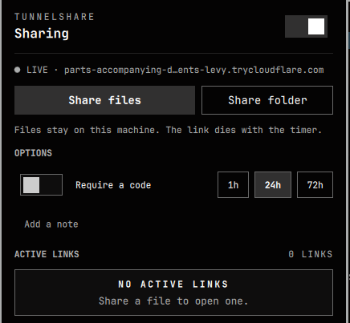
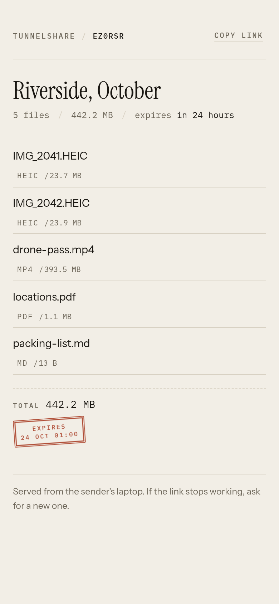

# TunnelShare

Share a file or a folder from your own machine. Your friend opens a link and
downloads. Nothing is uploaded to a third party, and every link expires.

[](https://github.com/Aakash-chouksey/omatunnel/actions/workflows/test.yml)
[](LICENSE)

| Omarchy panel | Friend page |
| --- | --- |
|  |  |

One daemon, two front ends. `tsd` serves the friend page, owns the database, and
supervises the Cloudflare tunnel. `tsctl` shares from the terminal. The Omatunnel
panel is a thin client over `tsctl`.

## Quick start on Omarchy

```bash
git clone https://github.com/Aakash-chouksey/omatunnel.git
cd omatunnel
./install.sh --enable
omarchy restart shell
```

Open the Omatunnel panel from the bar. Toggle Sharing, pick a file or folder,
and copy the link. The installer prints the live URL when the tunnel connects.
The code, if you set one, appears separately so you can send it in a second
message.

## Quick start on any Linux or macOS

```bash
git clone https://github.com/Aakash-chouksey/omatunnel.git
cd omatunnel
./install.sh --enable          # Linux with systemd
tsctl share ~/Pictures/Riverside --hours 24 --note "Riverside, October"
```

`tsctl` prints the link and the path. Send the link; send the code separately.

macOS has no systemd. Use the manual path in
[docs/manual-setup.md](docs/manual-setup.md) until the menu bar app lands
([issue #2](https://github.com/Aakash-chouksey/omatunnel/issues/2)).

## Let an agent install it

Copy the prompt in [AGENT_SETUP.md](AGENT_SETUP.md) into Claude, Codex, Cursor,
or any agent with shell access. It checks the prerequisites, installs
TunnelShare, verifies a real download through the public link, and reports the
URL. It asks before using sudo and does not delete your files.

## Requirements

| Tool | Needed for |
| --- | --- |
| Python 3.10 or newer | the daemon and the tests |
| `cloudflared` | the public link |
| systemd user services | `--enable`, the panel toggle |
| `qrencode` | the panel QR |
| `wl-copy` | the panel copy buttons on Wayland |

The installer creates its own venv and installs Flask. It never uses sudo. It
warns when `cloudflared` is missing.

## Manual setup

[docs/manual-setup.md](docs/manual-setup.md) covers the no-systemd run, macOS,
named tunnels, the config file, uninstall, and troubleshooting.

## Share

```bash
tsctl share ~/Pictures/Riverside --hours 24 --note "Riverside, October"
tsctl share ~/contract.pdf --pin 246810 --note "Contract, signed"
tsctl list
tsctl revoke <id>
```

The daemon reads files in place. It never copies, moves, or deletes them. A
folder is indexed once, so the page lists each file with its relative path.

On Omarchy, Omatunnel does the same. It reads the real state, offers
`Share files` and `Share folder`, an optional code, hours, a note, QR, copy,
revoke, and download progress.

The friend page is server rendered. Downloads are plain links with HTTP Range,
so the browser resumes after a dropped connection. No JavaScript is needed to
download.

## How it works

```text
tsctl / Omarchy panel
        |
        v
       tsd  ---- SQLite: shares + entries
        |        files read in place
        v
   cloudflared  (quick or named tunnel)
        |
        v
 Cloudflare edge  --->  friend browser
```

A share is one row and its entries. Expiry is derived. Revoking or expiring
deletes rows only; the bytes stay on your disk.

## Tunnel

`tunnel.mode` is `auto`, `quick`, or `named`.

- `auto` uses a named tunnel when `~/.cloudflared/config.yml` exists or
  `tunnel.name` is set. Otherwise it uses a quick tunnel.
- `quick` needs no account. The hostname changes on each restart, and
  Cloudflare gives it no uptime guarantee.
- `named` needs a Cloudflare account and a domain on Cloudflare. The hostname
  stays the same across restarts.

Quick tunnels use HTTP/2 by default (`tunnel.transport`). QUIC stalls on some
VPNs and Tailscale networks. The daemon probes the public URL against
`/healthz` and reports `verified`. The probe is advisory. A local probe can miss
while the edge propagates a new hostname, and the link still works elsewhere.
The tunnel is up as soon as `cloudflared` registers it. If the probe keeps
failing, `verified` goes false and the status carries
`local health check failed`, but the link stays visible.

## Speed

The download speed is the sender's upstream link. On this machine a 128 MB file
through a quick tunnel measured 3.1 MB/s. Four parallel range requests reached
3.4 MB/s, about 9% more. The upstream to Cloudflare measured 3.7 MB/s. A 20 GB
file therefore takes about 1.8 hours. The daemon serves from disk at over
1 GB/s on loopback, so the network is the limit, not the code.

## Limits

| Limit | Value |
|---|---|
| Largest single file | 100 GB (default; `TS_MAX_BYTES` overrides) |
| Entries per share | 5000 files or folders |
| Total size per share | Your disk; the daemon sets no total cap |
| Link lifetime | 1 to 720 hours (30 days); default 24 |
| Downloads per link | No cap; revoke or let it expire |
| Active shares | No hard cap; the database and disk are the limit |
| Parallel downloads | 200 in-flight requests on a quick tunnel, shared by every visitor; your uplink is the real limit |
| Shares per day | No quota; your uplink sets the practical limit |
| PIN | 4 to 8 digits; 8 tries, then a 10 minute lock |

At the measured 3.1 MB/s, a saturated link moves about 267 GB per day: 13
files of 20 GB, or 2 files of 100 GB. Parallel downloads share that one uplink.

100 GB is the per-file default. The daemon stores no copy; it streams the file
from your disk. `TS_MAX_BYTES` changes the cap. See [`LIMITS.md`](LIMITS.md) for
the full table and the Cloudflare side.

The free-plan 100 MB request body cap applies to uploads into Cloudflare. This
daemon never uploads the file, so that cap does not limit a share. The response
has no enforced size limit. Cloudflare's free-zone terms still treat very large
media as a paid service.

## API

Public, tunneled:

- `GET /s/<id>` the friend page
- `POST /s/<id>/unlock` the code form
- `GET /s/<id>/f/<n>` the bytes, honors Range

Admin, loopback only, needs `X-TS-Token`:

- `GET /api/status`
- `POST /api/shares` with `{paths, hours, note, pin}`
- `GET /api/shares` (each share carries `progress`)
- `DELETE /api/shares/<id>`
- `POST /api/tunnel/restart`

## Tests

```bash
bash tests/test_api.sh       # real HTTP against a temp data dir
bash tests/test_progress.sh  # progress during a throttled download
bash tests/test_tunnel.sh    # one real quick tunnel fetch
bash tests/test_limits.sh    # the per-file cap rejects one oversized file
```

`tests/test_api.sh` covers byte-identical downloads, Range, folder indexing,
admin auth, the public port boundary, the PIN flow, lockout, revoke, expiry, and
dotfile exclusion. The tunnel test needs network and `cloudflared`; the other
two do not. CI runs the first two.

## Security

- Share ids are 128 bits. The link is the capability. A code is optional.
- Codes are stored as PBKDF2-HMAC-SHA256 with 210k rounds and a per-share salt,
  compared in constant time. Eight wrong tries lock the share for ten minutes.
- Admin routes live on a separate loopback port behind a 0600 token. The tunnel
  points only at the public port, so it cannot reach them.
- Folders are indexed once. Symlinks that leave the folder and dot entries are
  skipped. A download request carries an index, never a path.
- Expiry deletes rows only. The sender's files are never touched.
- Download progress is in memory only. It resets on restart and stores no
  client identity.
- No telemetry and no third-party storage. The only network peer is Cloudflare.

## Development

```bash
python3 -m venv .venv
.venv/bin/pip install -r requirements.txt
.venv/bin/python tsd.py --no-tunnel       # http://127.0.0.1:8080
```

The design and contracts live in `docs/`: `direction.md`, `contract.md`,
`design-brief.md`, `panel-spec.md`. The plugin is a bar widget; validate it with
`omarchy plugin validate <clean-copy>`, where the copy excludes `.venv`, `.git`,
and runtime files.

## Uninstall

```bash
systemctl --user disable --now tunnelshare
omarchy plugin remove codejack.tunnelshare
rm -f ~/.config/systemd/user/tunnelshare.service ~/.local/bin/tsctl
rm -rf ~/.local/share/tunnelshare ~/.config/tunnelshare
```

This removes the app, the database, and the config. Your shared files are not
touched.

## Omatunnel marketplace

The repo root is a valid Omarchy plugin source. Install the daemon first, then
add Omatunnel:

```bash
omarchy plugin add https://github.com/Aakash-chouksey/omatunnel.git
```

Omatunnel alone shows `tsctl is not on PATH` until the daemon is installed. The
submission body and checklist are in
[docs/omarchy-submission.md](docs/omarchy-submission.md).

The product site is in `site/`: one static page with an animated tunnel hero,
an interactive console demo, four use cases, the yearly cost comparison, install
commands, and limits. Serve it with `python3 -m http.server -d site` and open
http://localhost:8000. There is no build step.

## License

MIT. See [LICENSE](LICENSE).
